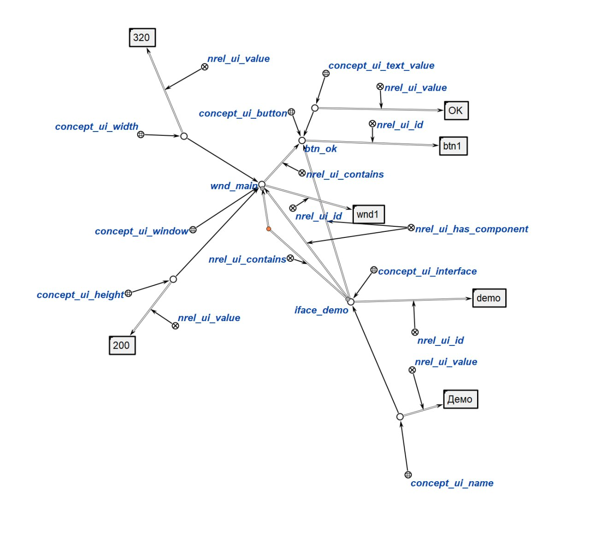

# Installation & Build

## ostis-ui

#### 1. Setup venv and conan

The project uses Conan to manage dependencies. 
Create venv, activate it and install conan.

```bash
python3 -m venv .venv
source .venv/bin/activate
pip3 install conan
```
#### 2. Clone Repository

First, clone the repository containing the ostis-ui:

```bash
git clone git@github.com:Glentas/ostis-ui.git
cd ostis-ui
git checkout demo
```

#### 3. Install Dependencies with Conan

Conan stuff can be found in ```/home/<Your_pc_name>/.conan2/```.

Sc-machine files can be found in: 
```/home/<Your_pc_name>/.conan2/p/sc-<something-something>/es/```.

Perform all commands below:

```bash
conan profile detect
conan remote add ostis-ai https://conan.ostis.net/artifactory/api/conan/ostis-ai-library
```

```bash
conan install . -s build_type=Release --build=missing
```

```bash
conan install . -s build_type=Debug --build=missing
```
#### 4. Configure Project

You can configure the project using CMake presets. 


After You installed all dependencies there are three main configuration options:
- Debug with tests:
  
  ```sh
  cmake --preset debug-conan
  ```

- Release:
  
  ```sh
  cmake --preset release-conan
  ```

- Release with tests:
  
  ```sh
  cmake --preset release-with-tests-conan
  ```

#### 5. Build Project

After configuring, You can build the project:

For debug build:

```sh
cmake --build --preset debug
```

For release build:

```sh
cmake --build --preset release
```

## sc-machine

#### 1. Download and extract

Download [GitHub Releases](https://github.com/ostis-ai/sc-machine/releases) and extract them to a location of Your choice.

#### 2. Build KB

Go to ```/path/to/extracted/machine/sc-machine-0.10.5-Linux/bin/```.

Build KB:

```bash
./sc-builder --input /path/to/folder/with/kb/files/ --output /path/to/kb.bin --clear
```

- ```/path/to/folder/with/kb/files/``` - folder that contains Your gwf's and scs's.
- ```/path/to/kb.bin``` - location where KB will be saved. You may change it's name: kb1.bin, my_kb.bin, etc.

#### 3. Start sc-machine

```bash
./sc-machine -s /path/to/kb.bin -e /path/to/ui_libs/build/Release/lib/
```

- ```/path/to/ui_libs/build/Release/lib/``` - location with dynamic ostis-ui libs. Library name is ```libostis-ui-html-translator.so```.

# Specs

## Example of abstract SC model in the knowledge base



## Current supported catalogue of the components and params

### Names in SC

| What | SC |
|---|---|
| interface | `concept_ui_interface` |
| root of component types | `concept_ui_object` |
| `components` | `nrel_ui_has_component` |
| `contains` | `nrel_ui_contains` |
| id | `nrel_ui_id` |
| property value | `nrel_ui_value` |
| inclusion of a type in `concept_ui_object` | `nrel_inclusion` |

### Component types

| id | Class |
|---|---|
| `image` | `concept_ui_image` |
| `sound` | `concept_ui_sound` |
| `text` | `concept_ui_text` |
| `divider` | `concept_ui_divider` |
| `spacer` | `concept_ui_spacer` |
| `menu` | `concept_ui_menu` |
| `menu_bar` | `concept_ui_menu_bar` |
| `list` | `concept_ui_list` |
| `scroll` | `concept_ui_scroll` |
| `window` | `concept_ui_window` |
| `text_field` | `concept_ui_text_field` |
| `text_area` | `concept_ui_text_area` |
| `slider` | `concept_ui_slider` |
| `select` | `concept_ui_select` |
| `button` | `concept_ui_button` |
| `menu_item` | `concept_ui_menu_item` |

### Properties

| Key | Class |
|---|---|
| `name` | `concept_ui_name` |
| `x` | `concept_ui_x` |
| `y` | `concept_ui_y` |
| `width` | `concept_ui_width` |
| `height` | `concept_ui_height` |
| `order` | `concept_ui_order` |
| `visible` | `concept_ui_visible` |
| `enabled` | `concept_ui_enabled` |
| `opacity` | `concept_ui_opacity` |
| `text_value` | `concept_ui_text_value` |
| `tooltip` | `concept_ui_tooltip` |
| `action_id` | `concept_ui_action_id` |
| `background_color` | `concept_ui_background_color` |
| `color` | `concept_ui_color` |
| `border_color` | `concept_ui_border_color` |
| `border_width` | `concept_ui_border_width` |
| `border_style` | `concept_ui_border_style` |
| `corner_radius` | `concept_ui_corner_radius` |
| `font_size` | `concept_ui_font_size` |
| `font_weight` | `concept_ui_font_weight` |
| `text_align` | `concept_ui_text_align` |
| `padding` | `concept_ui_padding` |
| `margin` | `concept_ui_margin` |
| `min_width` | `concept_ui_min_width` |
| `min_height` | `concept_ui_min_height` |
| `max_width` | `concept_ui_max_width` |
| `max_height` | `concept_ui_max_height` |

### Default values

| Property | Value |
|---|---|
| `x`, `y` | `24` |
| `order` | `1` |
| `visible` | `true` |
| `enabled` | `true` |
| `opacity` | `1` |
| `text_value`, `tooltip`, `action_id` | `""` |
| `background_color` | `#f4f4f4` |
| `color` | `#1a1a1a` |
| `border_color` | `#6f6f6f` |
| `border_width` | `1` |
| `border_style` | `solid` |
| `corner_radius` | `0` |
| `font_size` | `13` |
| `font_weight` | `normal` |
| `text_align` | `left` |
| `padding`, `margin` | `0` |
| `min_width`, `min_height`, `max_width`, `max_height` | `0` |